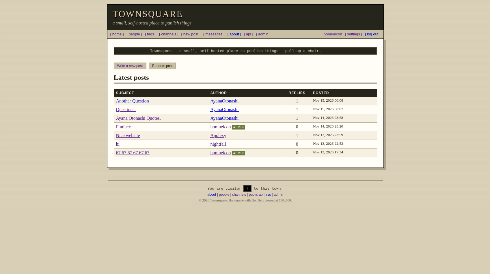

# Townsquare

A small, self-hostable, old-school social publishing framework. One domain, one binary:
profiles, posts, comments, invite-only membership, an admin panel, and a public REST API.
The look is deliberately Web 1.0: tables, serif type, blue links, a visitor counter, and
only a tiny local script for the emoji picker.

Version 1 is a single instance with a lightweight pull-based federation feed between
independently hosted towns. Full ActivityPub federation is on the roadmap.



## Features

- Profiles with bios, join dates, and locally moderated avatar photos
- Channels: general, memes, daily, suggestions, hall of shame, and an 18+ NSFW channel
  behind a warning
- Invite-only registration; email addresses are optional
- Markdown posts and threaded comments, sanitized before rendering
- Emoji picker and reactions; hashtags with tag filtering
- Direct messages with optional blocked-term monitoring
- Muting and blocking: hide people from feeds and comments, and close direct messages both ways
- Private bookmarks and "new since your last visit" markers on posts and comments
- Rate limiting, CSRF protection, one-time recovery codes, and admin reset links
- Attack mode: automatic flood lockdown that admits only previously recorded IPs and signed-in staff
- Roles: instance owner, admins, moderators, and members, with icons beside each name
- Staff panel: stats, invites, users, post moderation, blocked DMs, and a news ticker
- Pull-based federation: show recent public posts from other towns via `/federation/latest.json`
- Public read API, Bearer-token write API, RSS feeds, and Open Graph metadata
- SQLite storage (WAL); a single Go binary with no external services

## Quick start

Requires Go 1.27+.

```sh
go run ./cmd/townsquare
```

Open <http://localhost:8090> and complete `/setup`. Then create an invite under
**Admin -> Invites**. The database defaults to `townsquare.db` in the working directory.

Docker:

```sh
cp .env.example .env
docker compose up -d --build
```

The host port defaults to 8090 (`TS_PORT`). Data lives in the `townsquare_data` volume.
Behind an HTTPS reverse proxy, set `TS_SECURE_COOKIES=true` and `TS_TRUST_PROXY=true`.

## Configuration

| Variable | Default | Meaning |
| --- | --- | --- |
| `TS_ADDR` | `:8090` | Listen address |
| `TS_DB` | `townsquare.db` | SQLite database path |
| `TS_BASE_URL` | auto-detected | Optional fixed public URL override, no trailing slash |
| `TS_SITE_NAME` | `Townsquare` | Site name in the header and API |
| `TS_TAGLINE` | `a small, self-hosted place to publish things` | Header tagline |
| `TS_SECURE_COOKIES` | `false` | Set Secure cookies, HSTS, and upgrade-insecure-requests |
| `TS_ALLOW_SETUP` | `true` | Allow `/setup` while there are no users |
| `TS_OPEN_REGISTRATION` | `false` | Allow signup without an invite code |
| `TS_TRUST_PROXY` | `false` | Trust `X-Forwarded-*` for client IP and base URL |
| `TS_ALLOW_REMOTE_IMAGES` | `false` | Allow images hosted on other domains in Markdown |
| `TS_DM_BLOCKLIST` | empty | Comma-separated terms that block and flag a direct message |
| `TS_IMAGE_MODERATION` | `true` | Check avatar uploads with the embedded image safety model |
| `TS_IMAGE_NSFW_THRESHOLD` | `0.85` | Score at which an avatar is rejected as adult content |
| `TS_IMAGE_GORE_THRESHOLD` | `0.60` | Score at which an avatar is rejected as graphic violence |
| `TS_FEDERATION_INSTANCES` | empty | Comma-separated base URLs of other towns to pull posts from |
| `TS_FEDERATION_INTERVAL` | `10m` | How often to refresh remote posts (minimum 1m) |

By default the base URL comes from the request `Host` header. Set `TS_BASE_URL` to force one
canonical hostname. Set `TS_ALLOW_SETUP=false` only after the instance owner account exists.

## API

Browsable endpoint documentation is served at `/api`. Public reads need no authentication:

```sh
curl http://localhost:8090/api/v1/site
curl http://localhost:8090/api/v1/users
curl http://localhost:8090/api/v1/posts
curl http://localhost:8090/api/v1/posts/<id>
curl http://localhost:8090/api/v1/posts/<id>/comments
curl http://localhost:8090/federation/latest.json
curl http://localhost:8090/api/v1/users/<username>/posts
```

Read endpoints accept `limit` (max 100) and `offset`. Writes use a personal token from
**Settings -> API token** (shown once, stored as a SHA-256 hash):

```sh
curl -X POST http://localhost:8090/api/v1/posts \
  -H "Authorization: Bearer $TS_TOKEN" \
  -H "Content-Type: application/json" \
  -d '{"title":"Hello","body":"First post from the API."}'

curl -X DELETE http://localhost:8090/api/v1/posts/<id> \
  -H "Authorization: Bearer $TS_TOKEN"
```

Post bodies are Markdown. Responses include `body` and rendered `body_html`. NSFW posts are
web-only and hidden from all public API reads. Comment writes accept `body` and an optional
`parent_id`; comment reads include `parent_id` for replies.

## Development

```sh
make fmt
make vet
make test
make build
```

Layout:

```
cmd/townsquare        main entry point
internal/config       environment configuration
internal/store        SQLite schema and queries
internal/auth         passwords, sessions, tokens, validation
internal/markdown     goldmark + bluemonday rendering
internal/moderation   embedded image safety model and local ONNX inference
internal/web          HTTP routes, handlers, templates, static CSS
```

## Security and deployment

- Passwords use bcrypt; sessions are random, server-side, and expire after 30 days.
- Login, registration, recovery, reset, setup, and API writes are rate-limited.
- Attack mode enables automatically after a sustained burst of rate-limited requests, and can be
  toggled by an admin. While active, only IPs recorded by the visitor counter, signed-in staff,
  and localhost may enter; everyone else gets a 503 "This website is under attack." page.
- All forms use a CSRF token; cookies are `HttpOnly` and `SameSite=Lax`.
- Markdown is sanitized with bluemonday before it reaches a template.
- Avatars are decoded, cropped, resized, and re-encoded to PNG. Original uploads and SVG
  files are never served. The result is checked locally for adult content and gore on
  linux/amd64; other platforms skip the check, and `TS_IMAGE_MODERATION=false` disables it.
- Remote images are blocked by default to prevent tracking pixels.
- There is no built-in TLS. Run behind a reverse proxy with HTTPS, set `TS_SECURE_COOKIES=true`,
  and enable `TS_TRUST_PROXY=true` so forwarded headers are honored.

Everything is in the SQLite database. With the service stopped, copy `townsquare.db`. For a
live copy, use `sqlite3 townsquare.db ".backup backup.db"`.

## Roadmap

1. Actor documents and WebFinger for `@user@domain`.
2. Inbox and outbox endpoints plus HTTP Signatures.
3. Follow relationships and a delivery queue for posts and comments.
4. NodeInfo discovery and moderation tools.
5. Compatibility with the wider ActivityPub ecosystem where possible.

## License

AGPL-3.0-or-later. See [LICENSE](LICENSE).

## Uneeded

Readme is Ai-Generated
